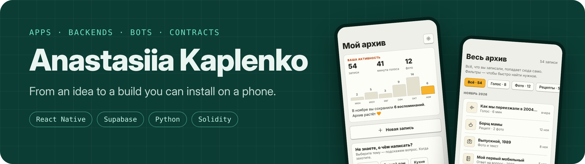

  

# Anastasiia Kaplenko

**Mobile apps, backends, Telegram bots and smart contracts.**
I take a project from an idea to a build you can install on a phone.

**Portfolio (in Russian): https://nasta11.github.io**
Telegram: [@NastaKasi](https://t.me/NastaKasi) · Based in Serbia, working remotely

Разрабатываю мобильные приложения, серверы, Telegram-ботов и смарт-контракты. Портфолио: https://nasta11.github.io

## What I build

| Area | Tools |
| --- | --- |
| Mobile apps (iOS and Android) | React Native, Expo, TypeScript, SQLite |
| Backend | Vercel, Supabase, PostgreSQL, Prisma, FastAPI |
| Bots and automation | Python, WebSocket, Telegram Bot API |
| Smart contracts | Solidity, OpenZeppelin, UUPS proxies, Hardhat tests |

## Projects

**Мой архив (My Archive)** — a mobile app for family memories: stories by voice, text, photo and short video, a family tree, shared family access by invite code, a PDF book. Works offline. Expo + React Native, with a Vercel + Supabase backend. Android test build; private repository.

**[Client Radar](https://nasta11.github.io/radar/)** — a free browser tool for small businesses: pick your trade and get search phrases that find people on Threads who are looking for your service right now. No sign-up, no server. In Russian.

**[LifeArchive](https://github.com/nasta11/lifearchive)** — a Web3 proof vault: client-side AES-GCM encryption, encrypted storage on IPFS, an on-chain SHA-256 proof. Base Sepolia testnet.

**[Upgradeable Token Factory](https://github.com/nasta11/upgradeable-token-factory)** — ERC-20 with Permit and role-based access, upgradeable through a UUPS proxy, cloned by a factory. Hardhat tests.

**[Solana real-time monitor](https://github.com/nasta11/solana-sniper-bot)** — a Python bot that watches Solana logs over WebSocket and sends Telegram alerts. Trading is simulated only. Graduation project for the OTUS "Solidity Developer" course.

**[Financial Market Analysis Platform](https://github.com/nasta11/financial-market-platform)** — a prototype: market data into PostgreSQL, charts, and a machine-learning forecast. FastAPI, Pandas, Plotly, scikit-learn.

**[Gas Optimizer](https://github.com/nasta11/gas-optimizer)** — a plain and an optimized version of one contract, with gas usage measured.

**[Trust-Governance Token Sale](https://github.com/nasta11/trust-governance-token-sale)** — architecture documents: trust model, threat model, security controls.

## Contact

Telegram: [@NastaKasi](https://t.me/NastaKasi)
